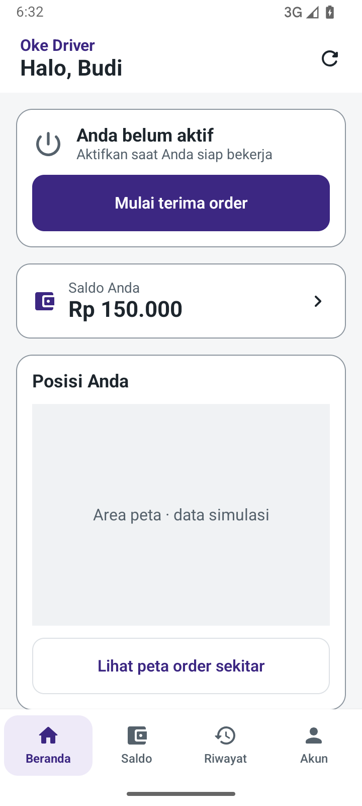
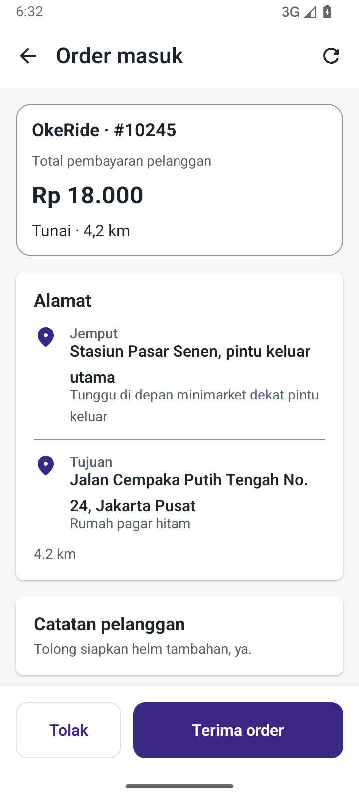
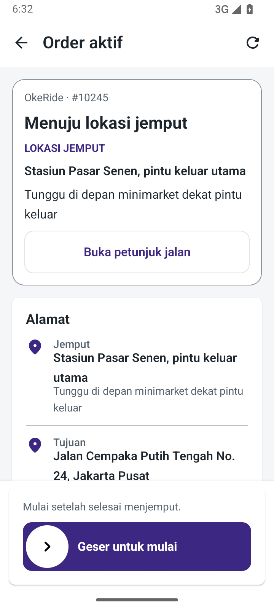
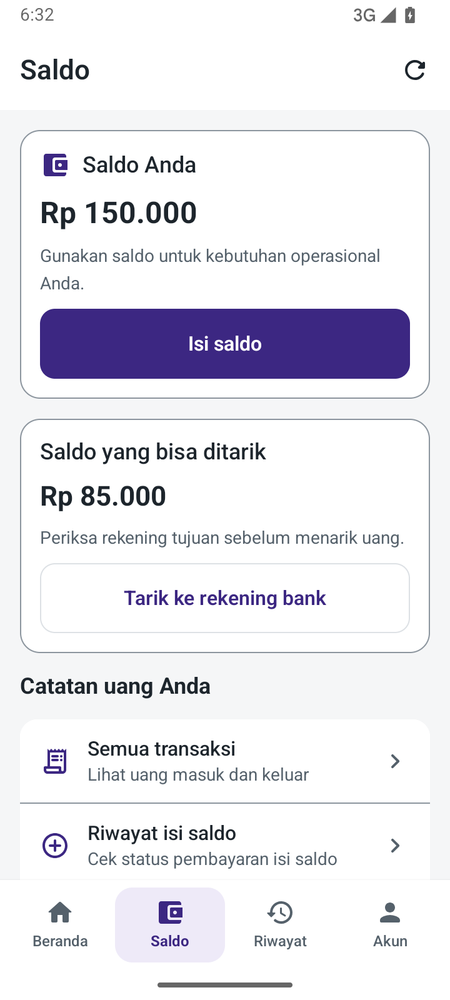
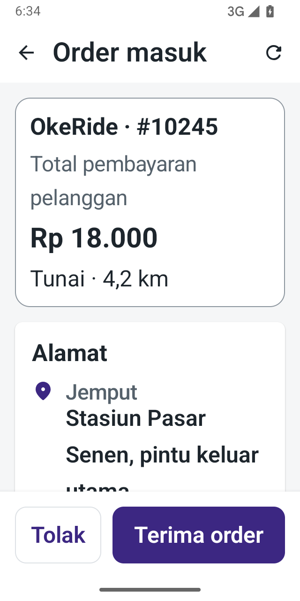
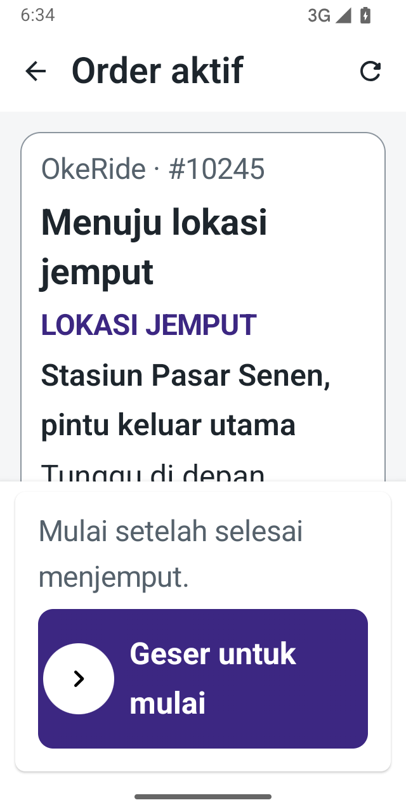

# Pratinjau Oke Driver — 2 November 2026

> Pembaruan berikutnya menyediakan pilihan **Sederhana** dan **Dinamis** dalam satu aplikasi. Lihat [galeri perbandingan kedua UI](../../ui-variants/2026-11-02/README.md). Gambar di halaman ini merupakan revisi Sederhana sebelumnya.

Tangkapan layar dari komponen Android asli menggunakan data simulasi pada build debug. Nilai saldo, pelanggan, dan order bukan data driver sungguhan. Area peta simulasi diganti peta Google pada aplikasi biasa setelah izin lokasi diberikan. Pratinjau Akun memperlihatkan keadaan ketika profil belum dimuat.

## Layar utama, 360 × 800 dp

| Beranda | Order masuk |
| --- | --- |
|  |  |

| Order aktif | Saldo |
| --- | --- |
|  |  |

[Riwayat order](history-phone-font1.png) · [Akun](account-phone-font1.png)

## Layar kecil, 320 × 640 dp, huruf 160%

| Order masuk | Order aktif |
| --- | --- |
|  |  |

[Beranda dengan huruf besar](home-compact-font1.6.png) · [Saldo dengan huruf besar](wallet-compact-font1.6.png)

## Layar lebar

[Beranda pada 1280 × 800 dp](home-wide-font1.png)

[Order aktif dengan tema gelap](current-phone-font1-dark.png)

## Pemeriksaan

Hasil tes interaksi dicatat di [usability-tests.txt](usability-tests.txt). Tes memakai layar selebar 320 dp dan skala huruf 160% untuk memeriksa navigasi, tombol menerima order saat konten digulir, perlindungan saat permintaan diproses, serta aktivasi tindakan perjalanan melalui semantik pembaca layar. Pemeriksaan ini belum menggantikan uji penggunaan bersama driver.

Rujukan pembanding, cakupan perubahan, dan batas pemeriksaan tersedia di [audit UI/UX](../../UI_UX_AUDIT_2026-11-02.md).
