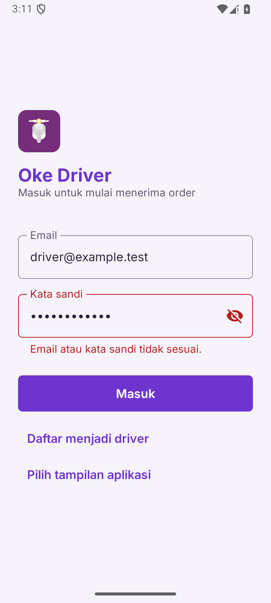
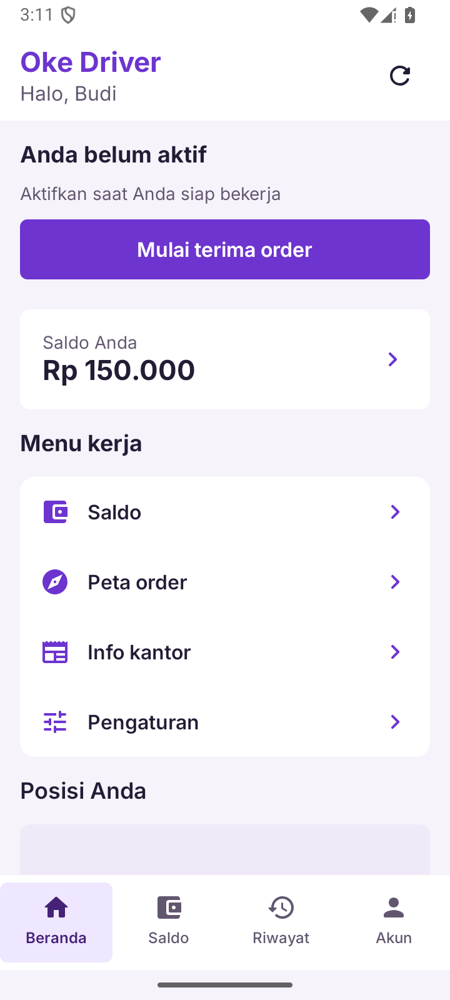
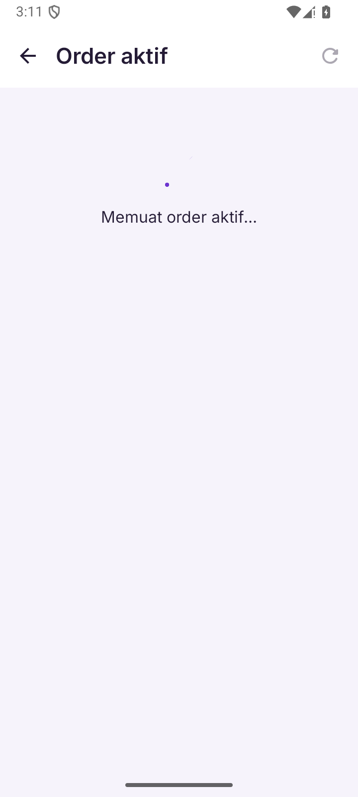
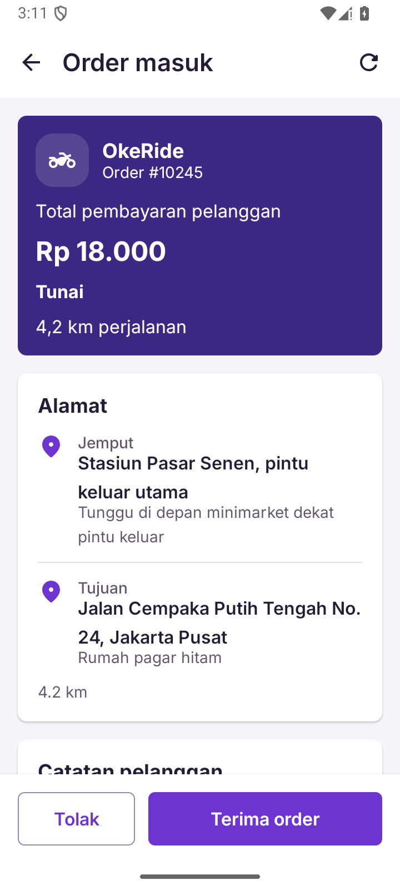
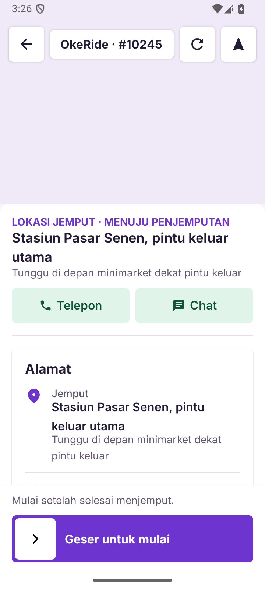
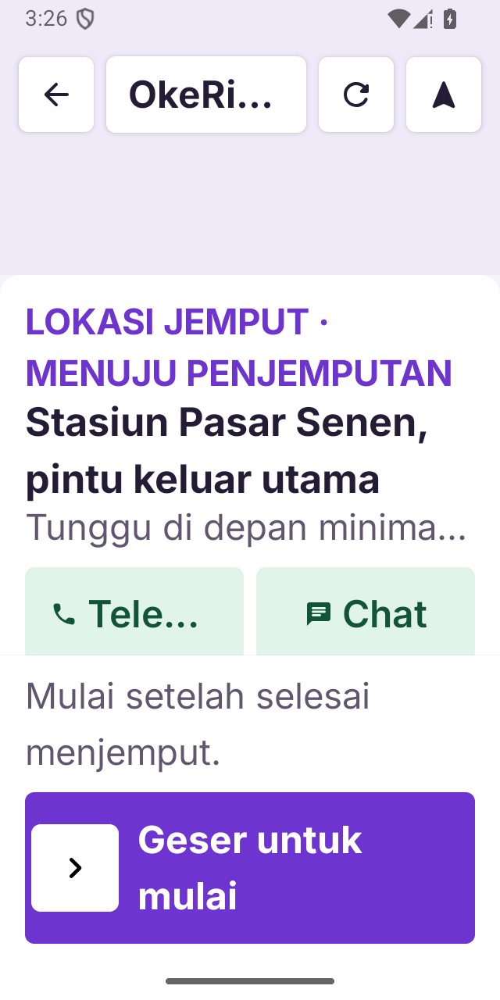

# Brand and UI review

Native Android captures with bundled Inter and the legacy purple logo. Screens render production composables using debug fixtures; no live driver account is involved.

| Login and credential error | Home |
| --- | --- |
|  |  |

| Loading an active order | Incoming order |
| --- | --- |
|  |  |

The credential message stays below the password field. Google login is absent. The home page scrolls normally, and action buttons use the shared 6 dp shape and 48 dp minimum touch target.

| Active order | Active order at 160% text, 320 dp width |
| --- | --- |
|  |  |

Order actions remain outside the scrolling detail area. The map and its controls occupy a separate region above the details. The map in this debug fixture is a neutral surface; production uses the connected order map.

Validation: 99 unit tests and 20 Android tests passed. The 12 usability cases were repeated successfully after the final map safe-area adjustment.
