# Perbandingan UI Sederhana dan Dinamis

Kedua tampilan tersedia di **satu aplikasi**. Dinamis menjadi pilihan awal. Ganti melalui **Akun → Tampilan aplikasi**, **Pengaturan → Tampilan aplikasi**, atau **Pilih tampilan aplikasi** pada layar masuk. Pilihan tersimpan di perangkat setelah aplikasi ditutup maupun setelah keluar akun.

Tangkapan layar di bawah berasal dari komponen Compose aplikasi yang dijalankan dengan data simulasi lokal pada emulator Android 15. Nama, saldo, dan order merupakan contoh. Tidak ada permintaan order, perubahan saldo, atau perubahan status driver di server.

## Ponsel 360 × 800 dp

| Layar | Sederhana | Dinamis |
| --- | --- | --- |
| Beranda | 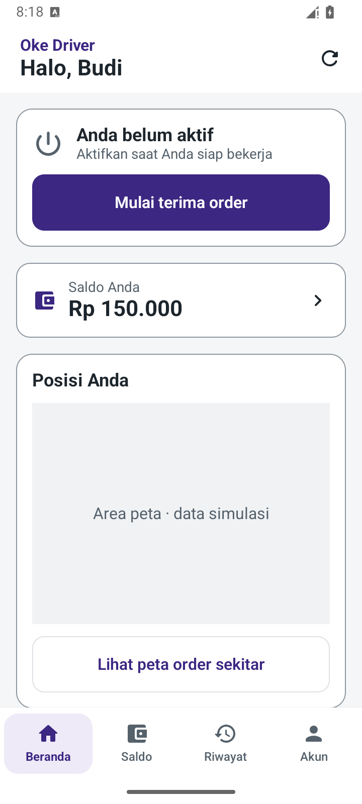 | 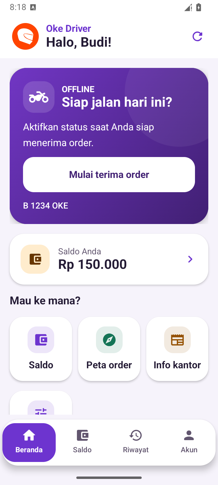 |
| Saldo | 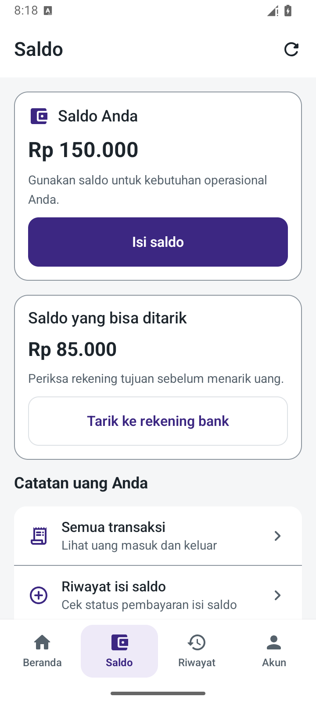 | 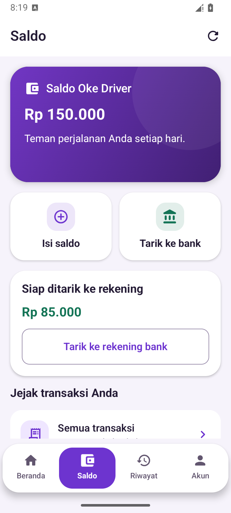 |
| Order masuk | 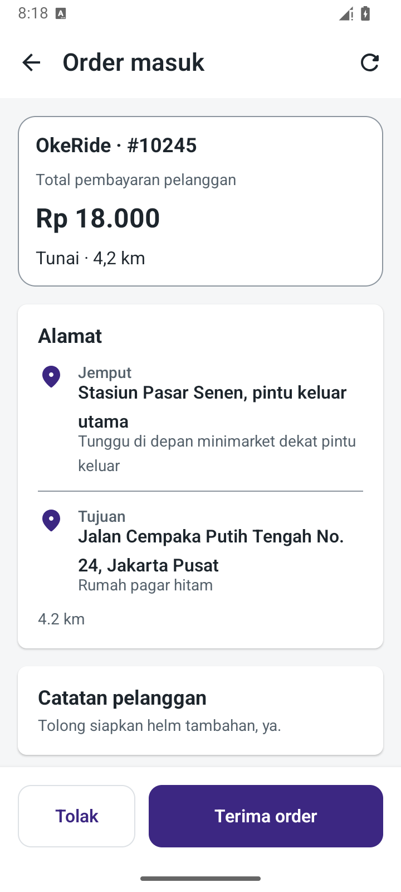 | 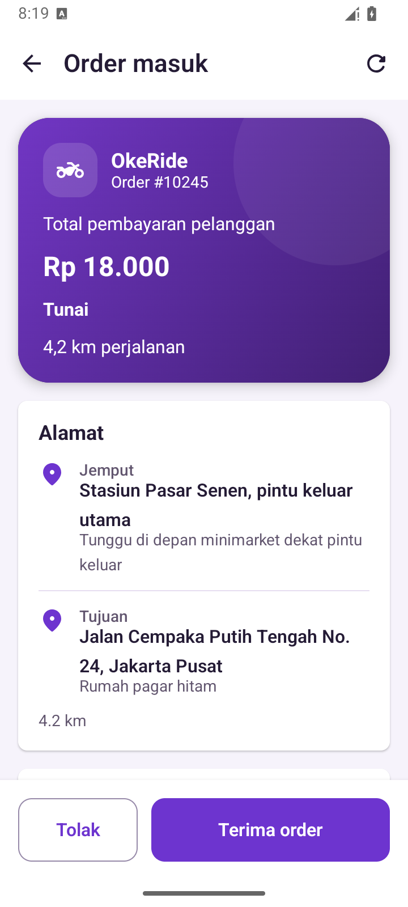 |
| Order aktif | 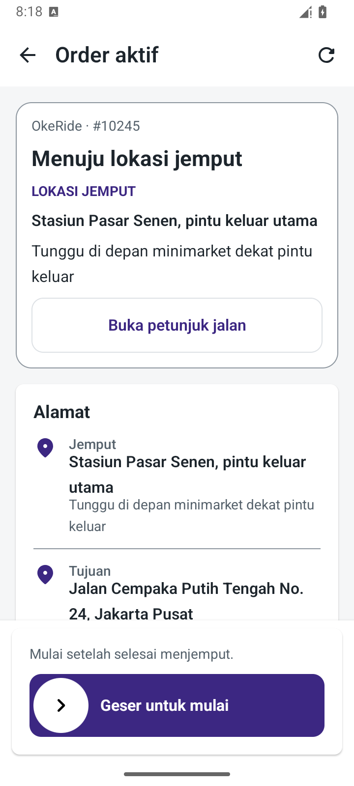 | 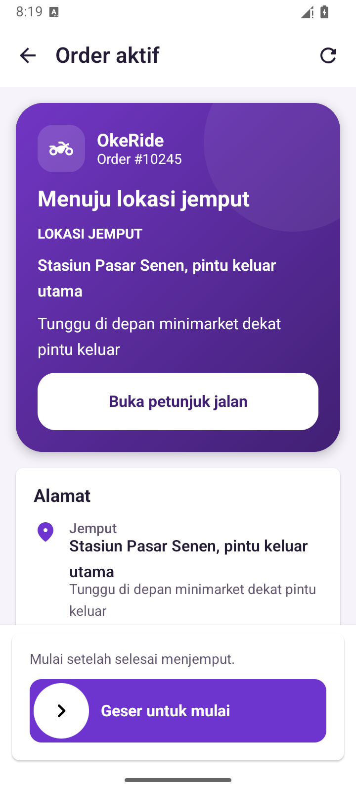 |
| Riwayat | 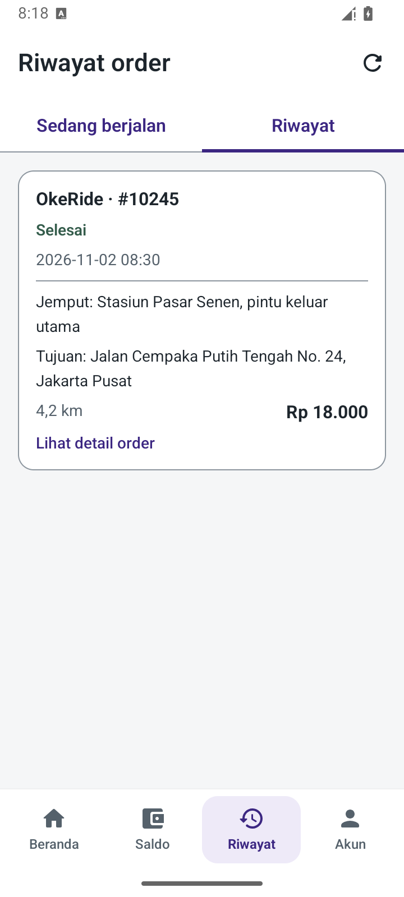 | 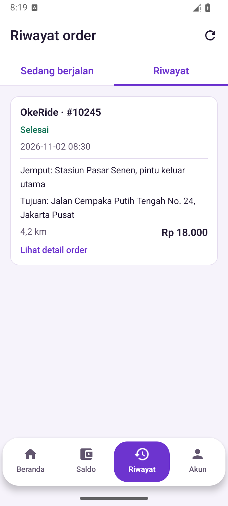 |
| Akun belum dimuat | 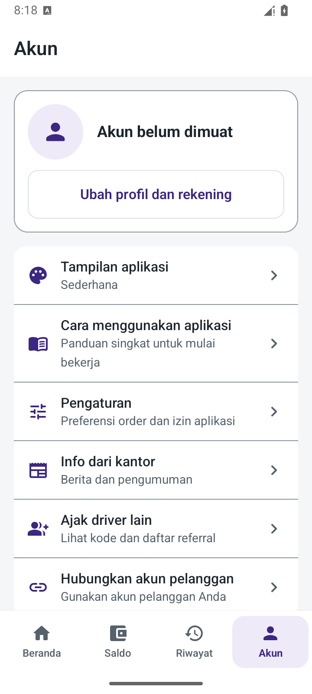 | 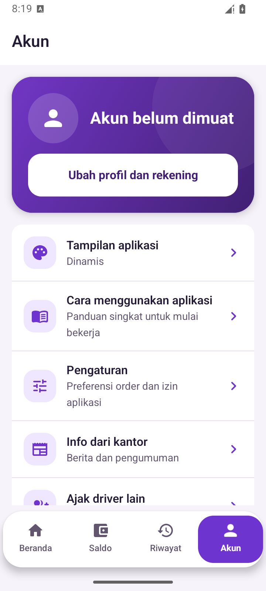 |

## Ponsel kecil dan teks besar

Lebar 320 dp, tinggi 640 dp, skala huruf 160%. Konten dapat digulir; tindakan utama order tetap berada di bagian bawah.

| Layar | Sederhana | Dinamis |
| --- | --- | --- |
| Beranda | 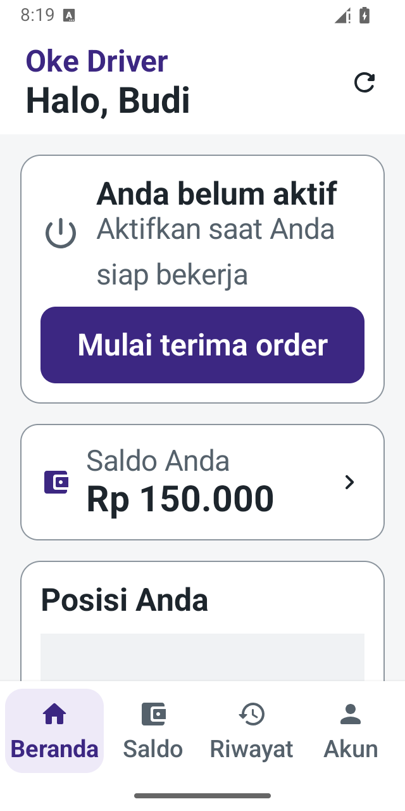 | 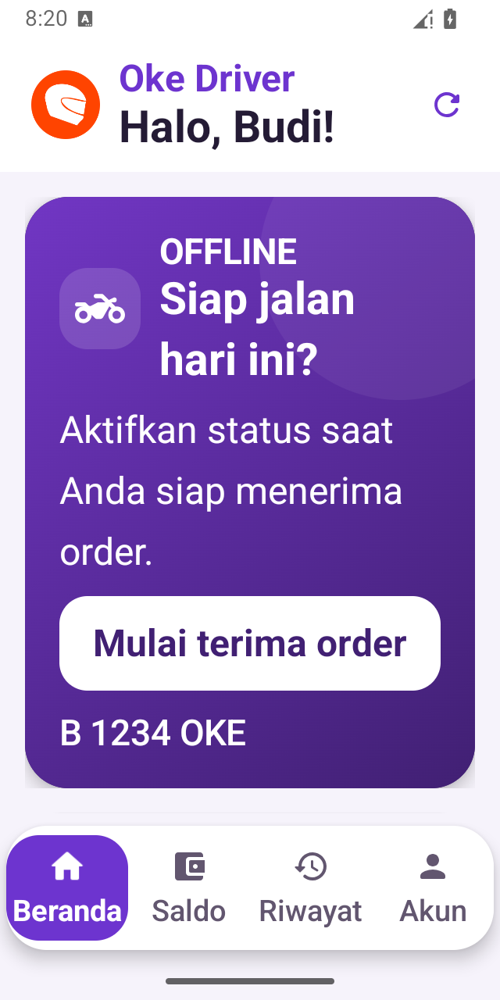 |
| Order masuk | 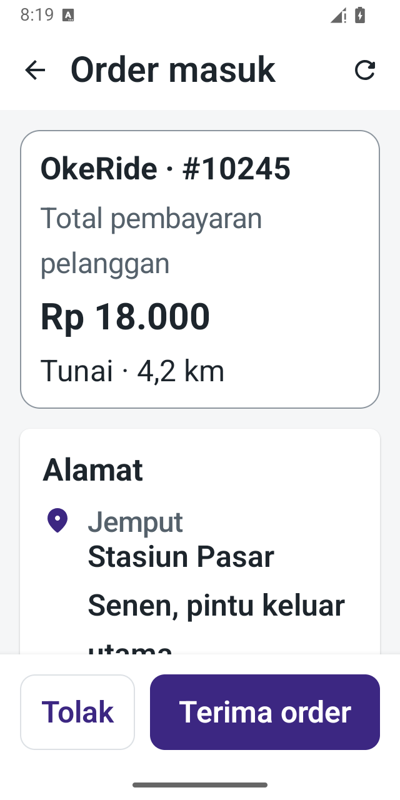 | 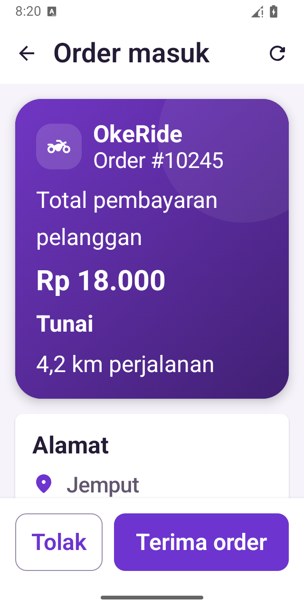 |
| Order aktif | 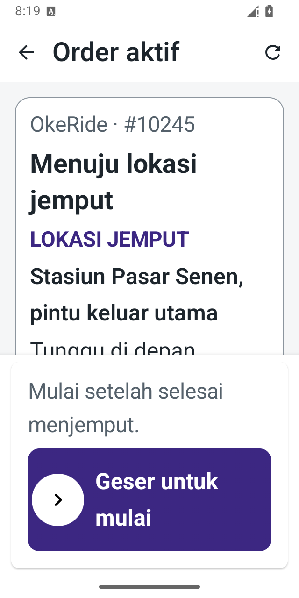 | 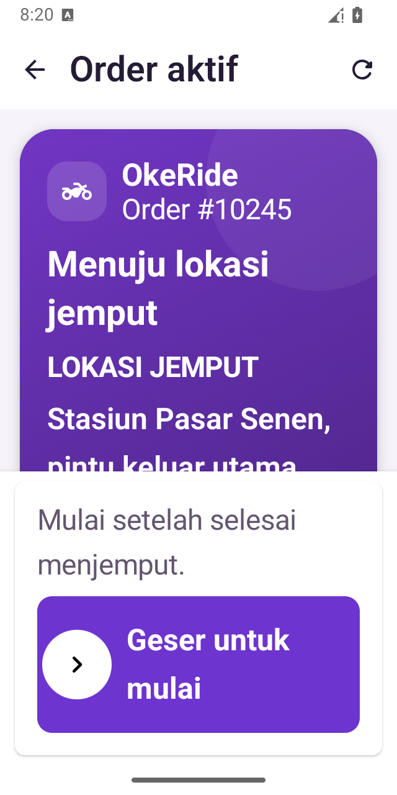 |

## Dinamis pada layar lebar dan mode gelap

| Layar lebar, 1280 × 800 dp | Mode gelap, 360 × 800 dp |
| --- | --- |
| 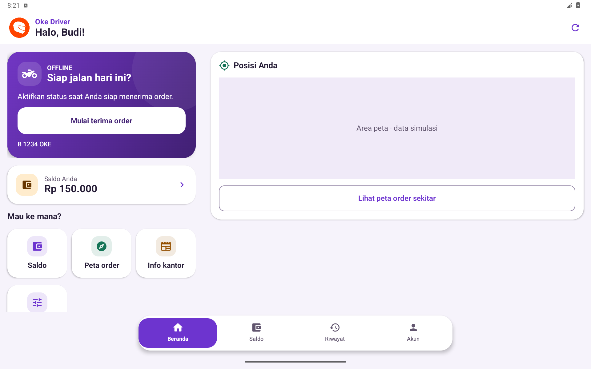 | 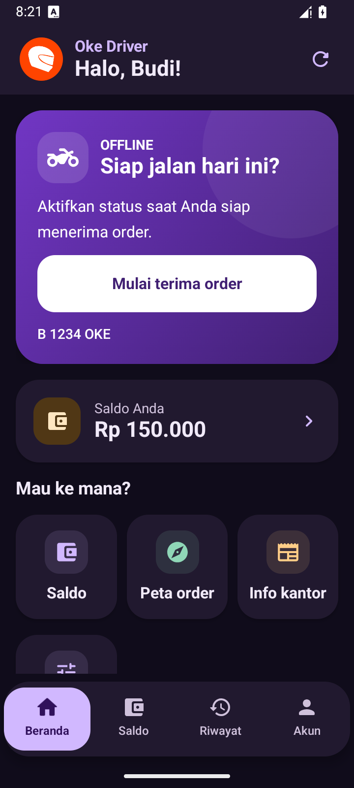 |

Lihat [penjelasan struktur dua UI](../../UI_VARIANTS.md). Galeri [revisi Sederhana sebelumnya](../../ui-review/2026-11-02/README.md) dipertahankan sebagai pembanding historis.

## Hasil pemeriksaan

Seluruh **20 tangkapan layar** berhasil dibuat. Peninjauan visual mencakup perbedaan kedua beranda, saldo, ringkasan order, menu pilihan tampilan pada Akun, tindakan order pada layar kecil dengan teks besar, susunan dua kolom pada layar lebar, dan kontras mode gelap.

**76 unit test dan 14 tes instrumentasi lulus.** Tes UI mencakup kedua tampilan pada lebar 320 dp dengan huruf 160%, tombol order yang tetap terlihat setelah menggulir, pemblokiran tindakan ganda, aktivasi tindakan lewat semantik aksesibilitas, pemblokiran status online sebelum akun dimuat, penyimpanan pilihan setelah sesi dihapus, dan pergantian UI sambil mempertahankan status driver.

Build APK/AAB release berhasil. Lint: **0 error, 63 warning, 2 hint**. Lihat [log instrumentasi](instrumentation-tests.txt) dan [rincian validasi serta artefak](../../UI_VARIANTS.md#hasil-verifikasi-2-november-2026). Data lokal ini belum menggantikan uji operasional dengan akun driver di backend.

## Reproduksi

Pasang APK debug pada emulator, lalu jalankan skrip berikut dari direktori `okedriver-app`. Gunakan serial emulator yang sesuai; skrip menolak perangkat fisik.

```powershell
py scripts/capture_ui_review.py --serial emulator-5580 --ui-style simple --output docs/ui-variants/2026-11-02/simple
py scripts/capture_ui_review.py --serial emulator-5580 --ui-style dynamic --output docs/ui-variants/2026-11-02/dynamic
py scripts/capture_ui_review.py --serial emulator-5580 --ui-style simple --preset compact --font-scale 1.6 --screens home incoming current --output docs/ui-variants/2026-11-02/simple
py scripts/capture_ui_review.py --serial emulator-5580 --ui-style dynamic --preset compact --font-scale 1.6 --screens home incoming current --output docs/ui-variants/2026-11-02/dynamic
py scripts/capture_ui_review.py --serial emulator-5580 --ui-style dynamic --preset wide --screens home --output docs/ui-variants/2026-11-02/dynamic
py scripts/capture_ui_review.py --serial emulator-5580 --ui-style dynamic --dark --screens home --output docs/ui-variants/2026-11-02/dynamic
```
